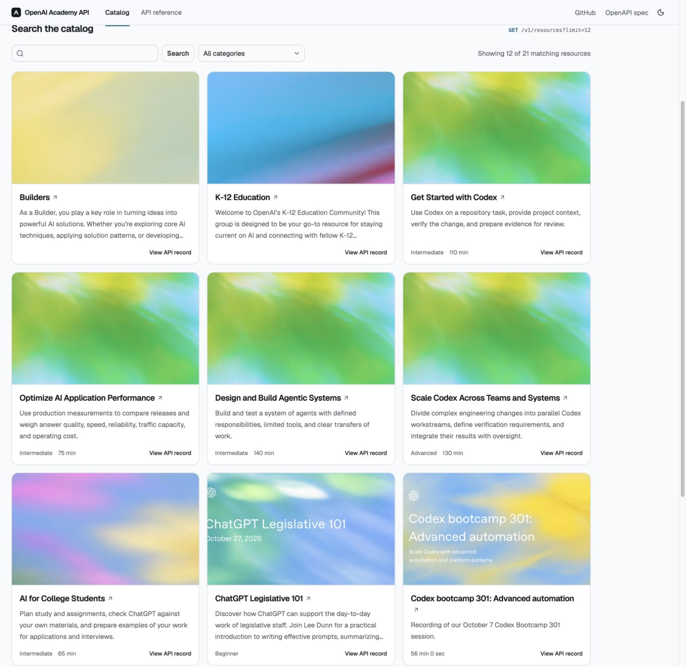

# OpenAI Academy Metadata API

> **Independent project:** Dominic Phillips is not affiliated with OpenAI, and this project is not endorsed by OpenAI.

I built this catalog and read-only metadata API to share with portfolio companies and internal teams so they can build learning resources for their employees. Browse the [live catalog](https://openai-academy.deployedwork.com/), or use the API to pull public resource metadata into your own tools with links back to the official [OpenAI Academy](https://academy.openai.com) pages.



## Public API and coverage limits

All read endpoints are public and require no authentication or `OPENAI_API_KEY`:

```bash
curl -s "https://openai-academy.deployedwork.com/v1/resources?limit=3" | python3 -m json.tool
```

| Endpoint | Description |
| --- | --- |
| `GET /v1/resources` | Paginated resource metadata with optional search, category, kind, and audience filters. |
| `GET /v1/resources/{id}` | Single resource metadata record by ID. |
| `GET /v1/categories` | Categories and resource counts for the active snapshot. |
| `GET /v1/status` | Snapshot freshness and per-category coverage. |

This service provides a partial snapshot of public metadata and official `https://academy.openai.com` source links; check [`GET /v1/status`](https://openai-academy.deployedwork.com/v1/status) for current coverage and freshness. It does not host courses, provision accounts, enroll learners, or grant access to gated courses. Sign-in and learning remain on OpenAI Academy.

## Run locally with the synthetic fixture

Requires Python `>=3.11` and [`uv`](https://docs.astral.sh/uv/) in a checkout of this repository. [`examples/collection.fixture.json`](examples/collection.fixture.json) contains one synthetic resource record for local verification (not live OpenAI Academy data). Import it into a temporary snapshot path such as `/tmp/academy-example/snapshot.json` rather than `data/snapshot.json`, then start the server:

```bash
uv sync --frozen
uv run --frozen academy-collector --snapshot /tmp/academy-example/snapshot.json import examples/collection.fixture.json --method fixture
uv run --frozen academy-api --snapshot /tmp/academy-example/snapshot.json --host 127.0.0.1 --port 8000
```

## Documentation, contributing, and license

- **API documentation and source:** See the [API Reference](https://openai-academy.deployedwork.com/reference), [Swagger UI (`/docs`)](https://openai-academy.deployedwork.com/docs), [OpenAPI 3.1 specification (`/openapi.json`)](https://openai-academy.deployedwork.com/openapi.json), [`schema/contract.json`](schema/contract.json), and the [GitHub repository](https://github.com/dominicphillips/openai-academy-api) for schemas, filter values, and pagination details.
- **Contributing:** See [`CONTRIBUTING.md`](CONTRIBUTING.md) for offline test, lint, and contract checks.
- **License:** Repository code is licensed under the [MIT License](LICENSE) (Copyright (c) 2026 Dominic Phillips). The MIT License covers this repository's software only and does not grant rights to OpenAI Academy courses, media, or other content.
